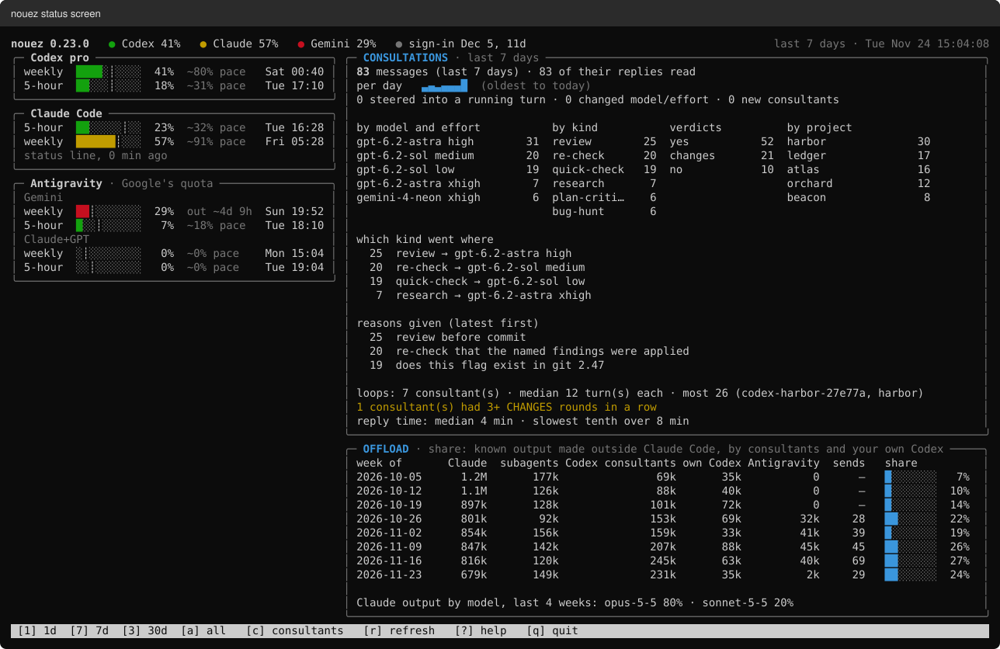
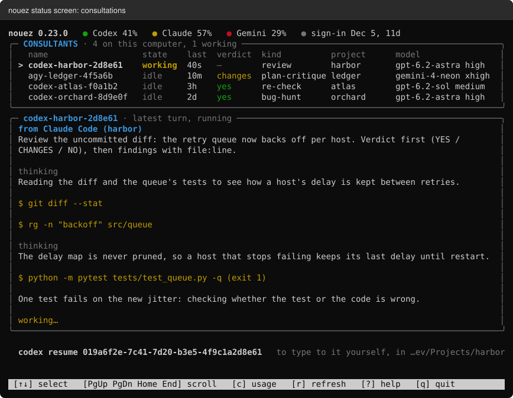
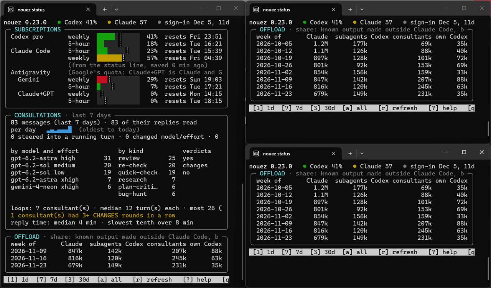

# Status screen and windows

Part of [nouez's documentation](../README.md#documentation).

## Usage log and status screen

nouez notes each consultation in `nouez/usage-log.jsonl` in your cache folder (`%LOCALAPPDATA%` on Windows, `~/.cache` elsewhere), one JSON line per event:

- **start:** a consultant started or reused, with its project and model.
- **send:** a message: the consultant, project, model and effort, which of those it changed, whether it steered a running turn, `kind` and `reason` if Claude gave them, its length in characters, whether it quoted your words, the digest of the diff `revision` took (never the diff), and each subscription's usage at that moment (as `ConsultantBudget` would show it), with, under `usage_meta`, when each of those windows resets and when it was read.
- **reply:** how the turn ended: status, time taken, length, and the verdict read from the reply's first line (`yes`, `changes`, `no`, or `incomplete` when the reply says it couldn't read what it was given or the turn didn't finish); for an Antigravity consultant, also its token counts.

Events of Antigravity consultants carry `provider: "antigravity"`, and their sends also record Antigravity's quota at that moment.

An event recorded while a client's request is handled carries `client`: the name the program connected to nouez gives itself, such as `claude-code`, as the program reports it.

It never holds the text of a message or reply; `reason` is Claude's one sentence on its choice, so it shouldn't quote anything sensitive. Each month, or sooner past 20 MB, it is renamed with the date and a new one starts. A renamed log is deleted a year after it was last written, and the oldest go first while they add up to more than 100 MB, so the status screen's "all" period covers what the kept logs hold, about a year. Set `NOUEZ_NO_USAGE_LOG=1` in nouez's environment to turn it off; that stops only this log, and an Antigravity consultant still keeps its turns in `nouez/agy/` (see [Files nouez keeps](how-it-works.md#files-nouez-keeps)).

To see it, with the usage of each subscription, run in a terminal:

```sh
python /path/to/nouez/server.py top
```



It shows, in boxed panels:

- **A top bar:** the version; the phone dispatcher's badge, when one is set up (`● dispatcher`: green while connected to Remote Control, amber while it isn't, red when its supervisor ended without being asked to); each subscription's most pressing window: a dot in its colour and its use, named when it isn't the weekly window (`● Claude 95% 5-hour`, `● AG Claude+GPT 82%`), with `busy` after it when its week is on pace past 70% (`● Claude 75% busy`; the colour stays green until 90%); and a sign-in badge: the date to renew Claude Code's sign-in by and the days left (`● sign-in Dec 5, 12d`), grey until 7 days before, then amber, red from the day before, then `sign-in ending` and `sign-in ended`.
- **Usage:** each Codex and Claude Code window, with a bar, the reset, and where the pace lands at the reset (red when used up or running out first, amber over 90%). In a week's first 16 hours the pace is a first-day estimate, the use so far spread over 16 hours, and says so (`~84% day 1`, or `day 1: out`, where the panel is narrow). A reading too old to project from (over 30 minutes) shows its age and the share used as the least the window will reach (`an old reading (45 min old): at least 93% by the reset`), coloured the same way, so a window past 90% stays amber however old the reading; routing, `ConsultantBudget` and the prompt hook judge each window the same way. When Claude Code's week is busy or tight, its note line adds what to hand out, as `ConsultantBudget` and the hook say it. A dotted mark (`┊`) in the bar shows how much of the window's time has gone: a bar filled past it is being used faster than evenly. Codex is read live from the daemon once a minute; without the daemon, from Codex's last session file. When Codex says a limit is reached, a `limit` row shows it used up, as the consultant suggestion treats it. A window that has reset is left out, here and in the usage log alike. Without Codex installed (and no Codex usage ever logged), its card and badge are left out. Claude Code's comes from the status line file (see [Choosing a consultant](consultants.md#choosing-a-consultant)). If the Antigravity CLI (`agy`) is installed, on your `PATH` or where its installer puts it on Windows, each of its quota groups too, checked once a minute with `agy -p /usage`, which runs no model turn and uses no quota; an answer is reused for 90 seconds, so the numbers can be up to about two and a half minutes old. They are listed under an Antigravity line; its "Claude+GPT" group is Claude and GPT models run inside Antigravity on Google's quota, apart from Claude Code's.
- **Consultations:** messages sent, and how many of their replies were read (with any that failed or were interrupted), steered and with a changed model or effort; counts by model, kind, project and verdict, each with its share (of the period's messages; for verdicts, of their replies read), which kind went to which model, and the latest reasons given; the median and slowest reply times; and consultants with three or more CHANGES rounds in a row. Verdicts and reply times are those of the period's own messages; other replies read, to earlier messages, are counted apart.
- **Offload:** for each of the last 8 weeks, the output tokens of Claude Code (and its subagents) beside those of nouez's Codex consultants, of your own Codex sessions and of Antigravity consultants (from the usage log, in the week each message was sent), the messages logged ("sends"), and the share made outside Claude Code, your own Codex sessions included; then Claude Code's output by model. A dash means nothing was recorded: weeks before the usage log began, or Antigravity turns that reported no tokens; a `+` after a number, that some of that week's did. The share is of the output known. These come from the Claude Code transcripts (`~/.claude/projects`) and Codex session files (`~/.codex/sessions`) on this computer. A reply copied into another transcript of the same session, as a forked subagent's starts with its parent's history, counts once. The first run reads the last 13 weeks of them, which can take a minute; the counts are kept in `nouez/usage-weeks.json` and later runs read only what was added.

With the 7- or 30-day period, a line of small bars shows the messages sent each day. The screen fits a terminal 100 columns wide, with the panels one above the other; from 149 columns, each subscription gets a card in a column on the left, beside the consultations and the offload table. On a short screen the optional lists go first, then older weeks (down to three), then the consultations' tables and last lines, then the remaining weeks and whole panels, so every box closes and the latest week stays. Keys, shown in the bar at the bottom: `1`, `7`, `3` or `a` to show 1, 7 or 30 days of consultations or all of them; `c` for the consultations page (below) and back; `r` to read usage and the consultants again now (in the background); `?` for a help page that says what the marks and columns mean (`?` or Esc goes back); `q` or Esc to quit. `--days N` picks the period to start with (0 for everything, up to 65535), `--page consultations` starts on that page, and `--once` prints the usage page, with those notes at the end, and exits; to a file or pipe it prints one column 104 wide. In a Windows console other than Windows Terminal (or another terminal that names itself), boxes have square corners and the mark is `|`, for fonts without the rounded ones. When `server.py` is updated, the screen starts again on the new version by itself, with the same period and page, so its header always shows the version installed. It waits until the new file has stopped changing, compiles and still holds the status screen; if the new screen fails all the same, the window waits for the next update instead of closing. The screen reads local files, asks the Codex daemon for its usage (which the daemon gets from OpenAI) and agy for Antigravity's quota (`agy -p /usage`, no model turn, which agy gets from Google), and runs `claude auth status --text` for the sign-in line; nothing else leaves your computer through nouez.



**The consultations page** (`c`, or `OpenStatusScreen` with `page: "consultations"`) lists the consultants nouez started on this computer, from every project (an older Codex one too, found in Codex's own list of sessions, with the usage log on or off): working ones first, then the most recently active, each with its state, when it was last active, the verdict of the reply to its last message and that message's kind (from the usage log), its project and its model. `↑` and `↓` (or `k` and `j`) select one. Below the list is its latest turn, kept up to date while it runs: the message it was sent (with the user's own words Claude Code passed on, under a label of their own), its thinking summaries, the commands it ran with any failing exit code, its searches and its messages, the newest at the bottom. Page Up, Page Down and Home scroll back through the turn; End follows it again. Under the turn is the command that opens the consultant in its own CLI and the folder to run it in: `codex resume <id> --remote unix://<socket>`, which names the socket of the Codex daemon nouez reads so that a terminal with another `CODEX_HOME` finds the consultant too (just `codex resume <id>` when the socket isn't where Codex keeps it), or `agy --conversation <id>`; a word with spaces is quoted. Text from a consultant or the usage log is shown without control or formatting characters, so it can't move the cursor, change colours or reorder what is shown. The page reads the list every 12 seconds and a running turn every 1.5, over one connection to the Codex daemon kept open while the screen runs, and Antigravity's turns from nouez's cache folder; it sends nothing to a consultant. A Codex session you opened yourself isn't listed.

**One status screen at a time.** `OpenStatusScreen` opens a window only when no status screen is open. Otherwise it switches the open one to the page asked for (and the period, when `days` is given), and on Windows asks for its window to be restored and brought forward, which Windows may show only as a flash in the taskbar. A screen you started yourself with `server.py top` counts as open, and a second `server.py top` switches the open one (to its `--page` and `--days`, if given) and exits rather than open another. A page asked for while the screen starts or restarts is applied once it runs, and only once. If a new window's screen hasn't started within 5 seconds, `OpenStatusScreen` says so rather than report it open.

## Arranging nouez's windows (Windows)

On Windows, ask Claude to arrange the windows nouez opened in Windows Terminal. These are the Claude Code sessions from `OpenClaudeSession`. The status screen isn't arranged: it stays where you put it. Automatic arranging is off until you ask Claude to turn it on. Other windows, your own terminals included, are never moved.



- **As windows open and close** the grid changes: one window is left where it is; two sit side by side; three make a tall one on the left and two on the right; and so on, in columns, the oldest window first, each box as close to a 16:10 shape as the count allows. The boxes share their edges and fill the screen; each window is sized to its box allowing for its invisible border, and counts as in place within a few pixels. A window that is minimized, maximized, on another virtual desktop, or whose tab you dragged into another window, is left out and the others take its room; restore it and it comes back.
- **Move a window by hand** and nouez takes it as a request. Drop it on another window and the two swap places. Take it to another screen and it stays there, out of the grid. Anywhere else, it goes back to its box.
- **The screen** is the one the oldest window was on when the grid began; nouez keeps it while windows are open. If it is unplugged, the windows move to another screen and the grid follows them there.
- **Too many windows:** each box needs about 60 by 16 characters (560 by 320 pixels at 100% scaling, 840 by 480 at 150%). A 1920 by 1200 laptop screen at 150% fits four, in a 2 by 2 grid; a 1920 by 1080 screen at 100% fits nine. Windows past what fits are left where they are, and the result of `ArrangeWindows` says how many.

Ask Claude to arrange the windows and it calls `ArrangeWindows`, which arranges them at once, brings back windows you took to another screen and arranges even a single one. To have nouez keep them arranged as windows open, close or are moved, ask Claude to turn on automatic arranging (`auto: true`). `auto: false` turns it off again: the windows then stay where they are, and `ArrangeWindows` still arranges them when asked. The setting is kept in `nouez/arrange.json` in your cache folder.

The arranging is done by a small process, `server.py arrange`, that nouez starts as needed while automatic arranging is on. It doesn't poll: it waits for Windows to report a window of Windows Terminal moved, minimized, restored, closed, or shown or hidden by a switch of virtual desktop, for a helper to end, or for the screen layout to change, then arranges once the events stop for 0.3 seconds. It ends 10 seconds after the last window closes. It uses only the standard library (`ctypes`), and nothing leaves your computer.
